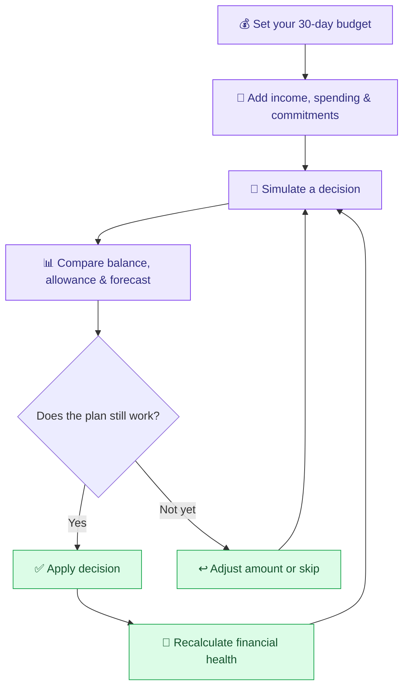

# ✨ Runway

> **Your money, your moves.** Plan a month. Test a purchase before you make it.

<p align="center">
  <a href="https://ntsppvuale.zite.so"></a>
  <a href="https://github.com/prachisingh24-ctrl/runway/actions/workflows/finance-quality.yml"></a>
  <a href="https://github.com/prachisingh24-ctrl/runway"></a>
</p>

<p align="center">
  
  
  
  
  
</p>

Runway is a personal-finance experience for Gen Z built around a limited **₹10,000 budget over 30 days**. It connects spending, income, subscriptions, commitments, savings goals, unexpected expenses, financial risk, and financial health—so every decision has a visible consequence.

**[Open the live app ↗](https://ntsppvuale.zite.so)** · [Explore the code](https://github.com/prachisingh24-ctrl/runway) · [Report an issue](https://github.com/prachisingh24-ctrl/runway/issues)

> [!TIP]
> **Try the signature flow:** open the app → enter your budget → visit **What if I…** → test a purchase → compare the forecast → apply it or save it as skipped. A simulation should help you decide *before* the money moves.

---

## 🧭 Jump in

| Want to… | Go to |
|---|---|
| 🚀 Try Runway | [Live app](https://ntsppvuale.zite.so) |
| 🌐 Deployment | [Open the deployed website](https://ntsppvuale.zite.so) |
| 🧠 Understand the decision simulator | [How it works](#-the-runway-loop) |
| 💸 Explore the feature set | [Features](#-built-for-real-life-money-decisions) |
| 🛠️ Run the project | [Setup](#-run-locally) |
| 🧪 Check financial calculations | [Tests](#-quality-checks) |
| 🏦 Explore the bank integration roadmap | [Bank integrations](#-bank-integrations-and-privacy) |
| 🧰 Review quality and performance standards | [Quality guide](docs/quality-and-performance.md) |
| 🤝 Contribute safely | [Contributing guide](CONTRIBUTING.md) |
| 🗺️ Explore the architecture | [Project map](#-project-map) |

## 🌈 Built for real-life money decisions

| Feature | What it helps you do |
|---|---|
| 💜 **Money dashboard** | See balance, daily allowance, commitments, month-end forecast, risk, and health score in one place. |
| 🧪 **Decision Simulator** | Preview one-time purchases, new subscriptions, cancellations, savings contributions, and extra income before applying a choice. |
| 📈 **30-day forecast** | Compare actual balance with projected cash flow and see how future transactions and renewals affect the finish line. |
| 🎯 **Savings goals** | Set a target and deadline, track progress, and see whether the current plan is on track. |
| 🔁 **Subscriptions** | Track recurring costs and upcoming renewals; simulate cancelling a subscription. |
| 🧾 **Spending & income** | Add, edit, search, filter, and sort money entries. |
| 📥 **Statement & SMS import** | Review CSV/XLS/XLSX statements or pasted bank/UPI SMS details before saving. |
| 🫶 **Financial health** | Explore the score factors, risk level, spending pace, emergency buffer, and next-step nudge. |
| 🏦 **Bank connections** | A preparation screen for a future consent-based integration; live bank syncing is not enabled yet. |

## 🧠 The Runway loop

The key idea is **simulate first, commit second**. The preview should not change saved financial records.



### 🔎 What a decision should change

A purchase is more than a line in a transaction list. Depending on the decision, Runway recalculates the affected values through the shared finance engine.

- **Balance:** what is available after posted transactions.
- **Daily allowance:** how much is available per remaining day after scheduled flows and upcoming renewals.
- **Day-30 forecast:** the estimated finish-line balance.
- **Risk:** Low, Medium, High, or Critical based on projected cash flow and buffer.
- **Savings goals:** whether deadlines remain achievable.
- **Health score:** a 0–100 estimate with a breakdown of contributing factors.

The numbers are planning estimates based on information entered by the user—not financial advice or a verified bank balance.

## 🚀 Deployment

Website: [https://ntsppvuale.zite.so](https://ntsppvuale.zite.so)

## 🛠️ Run locally

Runway uses Zite for authentication, database access, and backend endpoints. For the complete experience, open the live app or work from the connected Zite project. The repository contains the application source and project configuration.

### Prerequisites

- Node.js compatible with the project toolchain
- Corepack / Yarn
- Access to the connected Zite project for authenticated backend flows

### Start the app

```bash
corepack yarn install
corepack yarn dev
```

Vite uses port `8080` by default. Connect the project to its Zite environment to use authenticated sign-in, persisted data, and backend features.

### Useful commands

| Command | Purpose |
|---|---|
| `corepack yarn dev` | Start the development server |
| `corepack yarn build` | Type-check and build for production |
| `corepack yarn preview` | Preview the production build |
| `corepack yarn typecheck` | Run the project type check |
| `corepack yarn test:finance` | Run finance-engine regression checks |

## 🧪 Quality checks

Use these checks to keep the project reliable as you improve it:

```bash
corepack yarn typecheck
corepack yarn test:finance
corepack yarn build
```

The finance regression checks cover starting balance, posted and future transactions, cycle boundaries, chart/forecast consistency, and subscription-cancellation simulations. After merging changes, check the connected Zite deployment to confirm the latest version is published.

## 🗺️ Project map

```text
src/
├── api/                  # Authenticated backend endpoints
├── components/           # Shared UI, charts, indicators and app shell
├── lib/
│   ├── engine.ts         # Shared budget calculations and simulations
│   ├── finance.tsx       # Finance context, state and formatting helpers
│   ├── importers.ts      # Statement import helpers
│   └── sms.ts            # SMS parsing helpers
└── pages/                # Dashboard, simulator, spending, goals, health, etc.

docs/
└── bank-sync-integration.md  # Future bank-sync architecture and security plan

scripts/
└── test-finance-engine.mjs   # Finance-engine regression checks
```

### Stack

- **UI:** React 18, TypeScript, Vite, React Router
- **Design system:** Tailwind CSS and Radix UI
- **Charts & motion:** Recharts and Framer Motion
- **Forms & validation:** React Hook Form and Zod
- **Backend:** Zite authentication, database access, and server endpoints

## 🏦 Bank integrations & privacy

Runway is designed to support secure, consent-based bank integrations as the product evolves. The bank integration roadmap covers provider selection, explicit user consent, secure server-side credentials, transaction deduplication, and end-to-end verification.

Today, users can manage finances through manual entries, statement imports, and the available SMS-import flow. Review imported details before saving, and never enter bank passwords, UPI PINs, or OTPs into Runway.

Explore the [bank integration plan](docs/bank-sync-integration.md) for the proposed architecture and security checklist.

## 🤝 Contributing

1. Fork the repository and create a focused feature branch.
2. Keep financial calculations in the shared engine instead of duplicating formulas in UI components.
3. Add or update regression tests for changes to financial behavior.
4. Run type-check, finance tests, and build.
5. Open a pull request describing the user-facing impact and any assumptions.

Read the [contribution guide](CONTRIBUTING.md) and [quality/performance guide](docs/quality-and-performance.md) before making larger changes. Security concerns should follow [SECURITY.md](SECURITY.md). Ideas, bug reports, and improvements are welcome through [GitHub Issues](https://github.com/prachisingh24-ctrl/runway/issues).

## 📄 License

Runway is released under the [MIT License](LICENSE).
